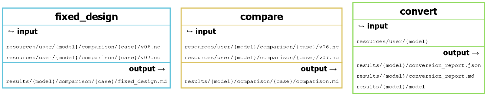
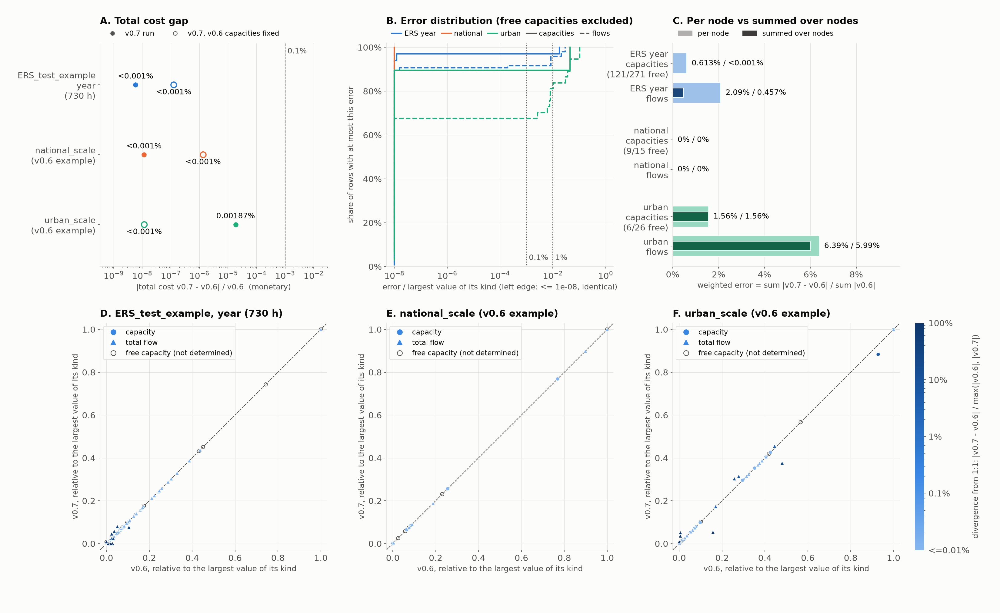

# Calliope model converter

A [Snakemake](https://snakemake.readthedocs.io/) module that converts legacy
[Calliope](https://calliope.readthedocs.io/) **v0.6** models (e.g. Euro-Calliope / EuroSPORES / ERS models)
into **Calliope v0.7.0** models. The layout follows the [Modelblocks](https://www.modelblocks.org/) convention.

The converter reads the legacy YAML and CSV files directly; it never imports Calliope v0.6.
It **does not run optimisations**: it converts the inputs, reports the legacy custom math, and the converted
model is then run with Calliope v0.7 as usual.

## What gets converted

| Legacy v0.6 | Calliope v0.7 |
|---|---|
| `techs` (`essentials`/`constraints`/`costs`), `parent` chains | flat techs with `base_tech`, renamed parameters (`energy_cap_max` → `flow_cap_max`, ...) |
| `tech_groups` (incl. extensions of built-in bases, e.g. `tech_groups.conversion`) | `templates` (`base_conversion`, ...) |
| `supply_plus` / `conversion_plus` (tiers, `carrier_ratios`, primary carriers) | `supply` + `include_storage` / `conversion` + tier-1 `carrier_ratios` → per-carrier `flow_out_eff`/`flow_in_eff`; tiers 2/3 → neutral ratios (`carrier_out_2_to_carrier_out_1_ratio`, ...) + generated math (`math/conversion_plus.yaml`, gallery CHP form). capacity as in v0.6 (one capacity on the primary carrier, shared by tier-1 outputs) |
| `locations` (comma keys, coordinates) | `nodes` (`latitude`/`longitude`) |
| `links` | one transmission tech per link (`A_to_B_<tech>`, `template: <tech>`) |
| `file=x.csv` timeseries | `data_tables` over the existing wide CSVs (copied, index header → `timesteps`; demand sign flipped and ratios inverted in derived CSVs) |
| costs (all cost classes) | `data_tables` (they merge element-wise, like v0.6 overrides did) |
| `group_constraints` | generated custom math (`math/group_constraints.yaml`) + `data_definitions` |
| `demand_share_per_timestep_decision` | adapted math-gallery formulation (`math/demand_share_per_timestep_decision.yaml`) |
| `model:` / `run:` (subset, resample, solver, SPORES, `relax_constraint`, ...) | `config.init/build/solve` + `data_definitions` |
| `overrides` / `scenarios` | `overrides` / `scenarios` (declared scenarios whose overrides set the same keys get a merged override, since v0.7 forbids duplicates) |
| custom math in `run.py` | time-varying limits (`math/time_varying_limits.yaml`), fuel distribution (`math/fuel_distribution.yaml`, annual balance), EV battery capacity (`math/storage_ev.yaml`), capacity factors (`math/capacity_factor.yaml`) and per-month production (`math/flow_out_per_month.yaml`) translated; the rest **reported, not translated** (see `conversion_report.md`); its inputs are carried over, renamed to the [math gallery](https://calliope.readthedocs.io/en/latest/examples/math_gallery/) names where one exists |
| run scripts (`run-*.py` with a `scenarios_string`) | a v0.7 run script next to the converted model: same settings, overrides selected by name and merged as in v0.6 (later wins); without `run.py` math |
| `dual_utils.py` | not needed: duals are a standard v0.7 output (`config.solve.shadow_prices`: energy balance + CO2 caps) |

All conventions and assumptions of the translation are listed in [docs/conventions.md](docs/conventions.md).

Every conversion writes `conversion_report.md`/`.json` and a log with all warnings
(undefined techs, unreferenced or invalid CSVs, unsupported keys, ...).

## Workflow



Three independent rules. `convert` turns a legacy model folder into a v0.7 model and its conversion report. The
optional `compare` and `fixed_design` rules check a converted model against its legacy original on runs you produce
and place in the case folder (see [Comparing v0.6 and v0.7 runs](#comparing-v06-and-v07-runs)). Regenerate the
figure with `pixi run dag`.

## Processing stages

1. Load the legacy model from its entry YAML (the one with a top-level `model:` key) and resolve `import:`s.
2. Resolve every tech (root base, carriers, tiers) from the base model and *all* overrides.
3. Convert the base model and each override; build data tables; generate custom math.
4. Statically analyse `run.py` and write the model, CSVs, math and report.

## Interface and configuration

- `INTERFACE.yaml`: input/output files and their default locations
  (legacy models in `resources/user/{model}/`, results in `results/{model}/`).
- `config/config.yaml` and `workflow/internal/config.schema.yaml`: configuration (see `config/README.md`).
- `tests/integration/Snakefile`: an example of how to use this module from another workflow.

## Comparing v0.6 and v0.7 runs

Optional, on **runs you produce** (the module never runs an optimisation): put `v06.nc` and `v07.nc` of one case in
`resources/user/<model>/comparison/<case>/` and run

```bash
pixi run snakemake --cores 1 -s workflow/Snakefile results/ERS_test_example/comparison/week_1h/comparison.md
```

`comparison.md` (with `comparison.png` and CSV tables) compares total costs, capacities, storage capacities and total
flows, per node and summed over nodes, with an overall error per section; capacities the optimum does not determine
(no capacity cost) are marked `free` and left out of the errors. The separate, optional `fixed_design` rule checks
whether the v0.6 solution is also optimal in v0.7 (one more solve per case). How to read both, their limits and the
results on the tested cases: [docs/consistency.md](docs/consistency.md). Shadow prices are not compared yet (future
development, see `reviews.md`).



*The converter on three tested cases, v0.6 and v0.7 solved with CBC: `ERS_test_example` over a year resampled to
730 h, and the Calliope v0.6.10 example models `national_scale` and `urban_scale`. A: the total cost of the v0.7 run,
and of the v0.7 run with the v0.6 capacities fixed, matches v0.6 well within 0.1%. B, C: the remaining differences in
capacities and flows, mostly the same solution allocated differently across regions. D-F: every capacity and flow
against the 1:1 line, coloured by its divergence. Details in [docs/consistency.md](docs/consistency.md).*

## Development

```bash
pixi install                      # development environment
pixi run test                     # unit, robustness and end-to-end tests
pixi run -e calliope test-calliope  # converted models load, build and solve with Calliope v0.7 (HiGHS)
pixi run test-integration         # Modelblocks standard tests (incl. the integration workflow)
pixi run dag                      # docs/figures/dag.png (workflow figure)
pixi run python docs/figures/make_consistency_figure.py  # docs/figures/consistency_cases.png
```

Converting a model in this repository (legacy models placed in `resources/user/<model>/`):

```bash
pixi run snakemake --cores 1 -s workflow/Snakefile results/ERS_test_example/conversion_report.md
# or, without Snakemake:
PYTHONPATH=workflow/scripts pixi run python -m converter.convert resources/user/ERS_test_example results/ERS_test_example/model --report results/ERS_test_example/conversion_report.md
```

Then, with Calliope v0.7:

```python
import calliope
model = calliope.read_yaml("results/ERS_test_example/model/eurospores/model-2018.yaml", scenario="v2g")
model.build()
model.solve()
model.results.shadow_price_system_balance  # duals of the energy balance
```

## References

- Calliope v0.7 migration guide: https://calliope.readthedocs.io/en/latest/migrating/
- Calliope math gallery: https://calliope.readthedocs.io/en/latest/examples/math_gallery/
- Modelblocks convention: https://modelblocks.readthedocs.io/

## Contributors

See `AUTHORS`.
